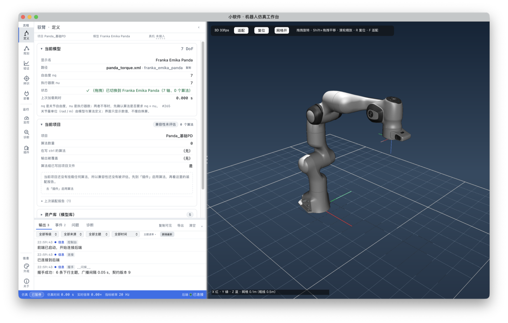

# 驭臂 · Yubi

> 基于 [MuJoCo](https://mujoco.readthedocs.io/) 的机械臂仿真与控制工作台。
> 自带桌面窗口：左边是 React 工作台，右边是 MuJoCo 原生 3D 视口。




## 这是什么

驭臂是一个面向机械臂算法开发与实验的桌面仿真软件。它把「选模型 → 配算法 → 调参数 → 规划轨迹 → 看曲线 → 辨参数 → 导出部署包」串成一条连续的工作流，而不是一堆互不相干的脚本。

和直接开 `mujoco.viewer` 或写 Python 脚本相比，它多了这些：

- **一个完整的桌面工作台**：10 个页面按「流程 / 运行 / 信息」组织，中区 3D 视口常驻。
- **真正的原生 3D**：3D 不是网页里画的运动学动画，而是 MuJoCo 在自研窗口右侧的原生 OpenGL 视口里渲染的；界面与物理各跑各的线程，不共享 `MjData`。
- **可插拔控制算法**：往 `算法库/` 放一个 `.py`，在项目文件里写上名字就能用；新增算法不需要改主程序。
- **项目配置驱动**：一个项目 = 模型 + 算法列表 + 参数。换模型时自动按项目重新装配算法。
- **把「结论」而不只是「数字」给出来**：监控页会判定振荡 / 发散 / 跟踪超差 / 饱和，每条告警都带量化证据。

> 这个项目不连接真机。部署页提供的是**可带走的部署包**与**设备链路模拟器**，不是硬件驱动。真机还需要协议后端（UDP / 串口 / CAN）和独立的物理急停回路。

## 功能一览

| 页面 | 能做什么 | 边界 |
|---|---|---|
| **定义** | 5 台机械臂的资产库，点选即加载；查看当前项目、自由度、执行器数、装配报告；按路径换模型 | 资产库只列本机已有模型，不支持远端下载 |
| **规划** | 记录关节航点 / 导入 CSV / 输入笛卡尔点；按真实关节限位做时间参数化，回算校验；轨迹落盘、一键执行（需先挂跟踪控制器）、换约束后与上次对比 | 笛卡尔只支持位置，姿态约束未实现；jerk 只校验不整形 |
| **验证** | 最近 120 秒实时曲线；各算法声明的参数表可直接编辑；改参数走「全成功或全回滚」的事务提交 | 曲线横轴是墙钟，不是仿真时间 |
| **辨识** | 闭环激励采样 → 后台辨识惯性参数 → 用新参数验证轨迹拟合 | 拟合更好只说明更贴近这段数据，不等于找到物理真值 |
| **部署** | 导出部署包（项目配置 + 算法源码 + 模型清单和 SHA-256）；设备控制台可连接模拟后端、走安全状态机、注入延迟/抖动/丢包/量化、演练断线、导出审计 | 只有模拟后端；没有真机协议后端和物理急停 |
| **监控** | 实时率 RTF、物理步频、进程内存；病态检出（振荡 / 发散 / 跟踪超差 / 饱和） | 没有热模型、驱动器侧跟随误差，也没有「没告警 = 没问题」的保证 |
| **诊断** | 在界面里真跑 11 套本机检查脚本，逐项报告通过/失败，可导出 JSON | 每次点击都重跑，没有「上次全绿」缓存 |
| **插件** | 列出本机算法库的插件、版本、作者、被哪些项目使用；在当前项目启用/停用 | 不是插件市场：不下载、不安装、没有远端仓库 |
| **外观** | 6 套皮肤（默认「工作台」）、中/英文切换 | 皮肤只改视觉，不改布局 |
| **关于** | 版本、构建方式、许可证、第三方组件、契约与后端连接信息 | — |

此外：

- **3D 视口**：左键拖动旋转、Shift + 拖动平移、滚轮缩放、`R` 复位、`F` 自动适配；支持日志里点击关节号在 3D 中高亮。
- **底部控制台**：输出 / 事件 / 问题 / 诊断四个页签，支持按等级、来源、插件、主题、时间筛选。
- **工程面板**：窗口较窄时在 3D 下方出现原生日志镜像，展开时网页控制台自动让位，避免两份日志打架。

## 快速开始

### 环境要求

- macOS（自研宿主窗口使用 PyObjC + AppKit / WebKit；Windows / Linux 尚未验证）
- Python 3.10（实测 3.10.21）
- MuJoCo 3.13.0
- 运行不需要 Node.js；前端构建产物已经入库

> 仓库里**没有** `.venv/`、`输出/` 和 `*.app/`。`.venv` 约 190 MB，用脚本重建；`.app` 是本机生成物，需要时自己打。

### 1. 取代码并重建环境

```bash
git clone https://github.com/cyberhu-riaty/yubi.git
cd yubi
bash 工具/重建环境.sh
```

脚本会创建 `.venv`、安装 MuJoCo 3.13.0、WebSocket 通信和 macOS 窗口依赖，并同步前端生成物。

如果只想手工处理：

```bash
.venv/bin/python -m pip install -r requirements.lock
```

### 2. 启动

```bash
# 主入口：自研窗口 = React 界面 + 原生 3D 视口
.venv/bin/python 软件/主程序窗口.py

# 浏览器入口：同一个数据层，没有原生 3D
.venv/bin/python 软件/主程序Web.py
```

启动后默认**物理是冻结的**，这是刻意的：先看清模型，再决定怎么动。要跑起来：

1. 在「定义」页确认模型与项目；
2. 在「插件」页启用需要的算法（项目文件的 `算法` 默认是空列表）；
3. 点底部状态栏的「仿真」开关，或启动时加 `--开重力`。

常用参数：

```bash
.venv/bin/python 软件/主程序窗口.py --检查                 # 不开窗，只自检
.venv/bin/python 软件/主程序窗口.py --模型 模型/universal_robots_ur5e/ur5e_torque.xml
.venv/bin/python 软件/主程序窗口.py --项目 UR5e_基础PD
.venv/bin/python 软件/主程序窗口.py --开重力
.venv/bin/python 软件/主程序窗口.py --无3D                  # 不要 3D 视口（排查用）
.venv/bin/python 软件/主程序窗口.py --web口 8899            # Web 服务换端口（默认 8712）

.venv/bin/python 软件/主程序Web.py --不开浏览器
.venv/bin/python 软件/主程序Web.py --web口 8899
```

### 3. 想要桌面图标（可选）

```bash
.venv/bin/python 工具/打包应用.py \
  --名字 小软件 \
  --输出名 小软件 \
  --主程序 软件/主程序窗口.py
```

生成的 `.app` 在包根目录，双击即可启动。它只是启动器 + 图标，不含 Python 环境；换机器后仍要先跑 `工具/重建环境.sh`。

## 项目结构

```text
yubi/
├── 软件/                  运行时：宿主窗口、Web 桥、参数/规划/辨识/部署桥、设备层
├── 前端/                  React 19 + Vite 7 + Tailwind 4 源码（构建产物在 软件/web/）
├── 算法库/通用/           控制、录制、辨识插件与算法模板
├── 模型/                  MuJoCo 模型与网格资产（5 台机械臂 + Robotiq 2F85）
├── 项目/                  项目配置：一个项目 = 模型 + 算法列表 + 参数
├── 工具/                  环境重建、模型导入、URDF→MJCF、打包、前端资产生成
│   └── 验证/              12 套可独立运行的检查脚本（诊断页跑其中 11 套）
├── docs/                  使用手册与界面截图
├── CHANGELOG.md           版本变更记录
├── CONTRIBUTING.md        协作约定
└── requirements.lock      依赖版本基线
```

运行期产物写在 `输出/`（首次运行自动创建，已在 `.gitignore` 中）：

| 目录 | 内容 |
|---|---|
| `输出/04_记录/` | 数据录制文件与 `.meta.json` |
| `输出/05_轨迹/` | 规划结果（CSV + 元信息） |
| `输出/部署/` | 导出的部署包 |
| `输出/设置.json` | 上次使用的模型、项目、语言等本机偏好 |

## 扩展一个控制算法

**不需要改主程序。** 三步：

```bash
# ① 复制模板
cp 算法库/通用/我的控制律_模板.py 算法库/通用/我的算法.py

# ② 改类名、名称、英文名、说明，在 每步控制() 里写控制律
# ③ 在项目文件里登记，或在「插件」页启用
```

一个最小插件长这样：

```python
import 插件系统 as 插件
from 插件系统 import 控制插件, 每步


class 我的插件(控制插件):
    名称 = "我的控制算法"
    版本 = "0.1"
    英文名 = "My controller"
    说明 = "一句话说清它干什么"

    @每步
    def 每步控制(self, event: 插件.messages.StepEvent) -> bool:
        数据 = event.data
        数据.ctrl[:] = 数据.qfrc_bias      # 6 个关节的力矩，N·m
        return False
```

注意：

- `@每步` 方法必须有类型标注 `event: 插件.messages.StepEvent`，否则官方插件系统会拒绝；
- 文件名不能以数字开头；
- 控制的是 `event.data.ctrl[:]`（关节力矩），不是位置；
- `名称` / `说明` 用于中文界面，`英文名` 用于英文界面。

登记到项目：

```json
{
  "项目": "UR5e_基础PD",
  "模型": "模型/universal_robots_ur5e/ur5e_torque.xml",
  "算法": [{ "插件": "关节pd控制" }, { "插件": "我的算法" }],
  "参数": { "关节 PD 位置控制": { "KP": 320.0 } }
}
```

`算法` 写 `"*"` 表示使用算法库中的全部插件。列表顺序就是每步执行顺序，最后一个写 `ctrl` 的插件说了算。

## 模型库

| 模型 | 自由度 | 推荐文件 | 许可证 |
|---|---|---|---|
| Universal Robots UR5e | 6 | `ur5e_torque.xml` | BSD-3-Clause |
| Universal Robots UR10e | 6 | `ur10e_torque.xml` | BSD-3-Clause |
| Franka Emika Panda | 7 | `panda_torque.xml` | Apache-2.0 |
| KUKA LBR iiwa 14 | 7 | `iiwa14_torque.xml` | BSD-3-Clause |
| UFACTORY xArm7 | 7 | `xarm7_torque.xml` | BSD-3-Clause |
| Robotiq 2F85（夹爪） | 8（非独立控制） | `2f85.xml` | BSD-2-Clause |

务必使用 `*_torque.xml`：这些变体把执行器改成力矩输入，`ctrl` 能直接被控制插件驱动。原始模型用于可视化或别的用途，不保证 `nu == nv == nq`。

模型来源与许可见各模型目录内的 `LICENSE`。需要导入更多模型：

```bash
.venv/bin/python 工具/导入模型.py --列表
.venv/bin/python 工具/导入模型.py universal_robots_ur5e
```

## 验证

界面「诊断」页可以一键跑 11 套检查。也可以在终端单独跑：

```bash
.venv/bin/python 工具/验证/契约自检.py
.venv/bin/python 工具/验证/校验项目.py
.venv/bin/python 工具/验证/轨迹规划自检.py
.venv/bin/python 工具/验证/参数事务自检.py
.venv/bin/python 工具/验证/病态检出自检.py
.venv/bin/python 工具/验证/设备契约自检.py
```

另有入口自检：

```bash
.venv/bin/python 软件/主程序窗口.py --检查
```

这些脚本都是独立可执行的：有自己的退出码，不依赖界面。诊断页用子进程调用它们，跑的就是你在终端里敲的同一批脚本。

## 已知边界

这份清单是刻意写出来的，避免把「没有」误当成「有」：

- **平台**：宿主窗口只在 macOS 上实现并验证。浏览器入口不依赖 AppKit，但同样只在 macOS 上跑过。
- **真机**：没有 UDP / 串口 / CAN 后端，也没有物理急停。部署页的「急停」只是软件请求。
- **轨迹规划**：只做关节空间时间参数化；笛卡尔航点只支持位置，不支持姿态约束；不支持圆弧/直线基本元；jerk 只校验，不做 S 曲线整形。
- **参数辨识**：验证的是「辨识结果比标称值更贴近这段数据」，不是「找到了物理真值」。
- **监控**：病态检出只覆盖四类已知模式；没有模型失配、温度、驱动器侧跟随误差。
- **插件**：只有本机算法库，没有远端安装、签名校验或版本服务器。
- **3D**：没有幽灵姿态、录制回放等叠加显示。

如果你要拿它做真机控制，请把 `软件/设备/` 当作接口参考，而不是安全认证组件；真机必须自己实现协议后端、硬件看门狗和独立的物理急停。

## 文档

- [使用手册](docs/使用手册.md) —— 10 个页面逐页说明、典型工作流、故障排查
- [前端约定](前端/约定.md) —— 前端目录边界、数据流、构建方式
- [变更记录](CHANGELOG.md) —— 每个版本改了什么、影响了谁
- [参与贡献](CONTRIBUTING.md) —— 分支、验证与 PR 要求

## 许可证

驭臂自身的源代码与文档采用 [MIT License](LICENSE)。

`模型/` 中的模型与网格来自多个上游项目（MuJoCo Menagerie 等），分别遵循各自目录下的 `LICENSE`，再分发时请一并保留。前端依赖（React、Vite、Tailwind 等）遵循各自的许可证。MuJoCo 由 Google DeepMind 开发，采用 Apache-2.0 许可证。
