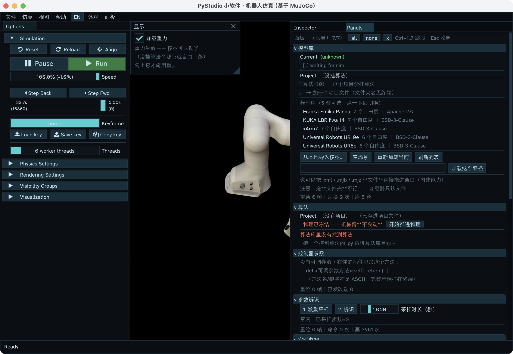

# 导师演示：5–10 分钟现场流程

> **场景**：导师 / 组会现场演示 · 原生界面（ImGui + Filament 3D）
> **默认时长**：8 分钟（含收尾）｜5 分钟裁剪版见 §4｜10 分钟扩展版见 §5
> **版本**：2026-10-17 · 适用当前工作区（MuJoCo 3.13.0 / Python 3.10）
> **配套**：[演示手卡.md](演示手卡.md)（打印一页，台上用）



> 图是布局参考（截图较早，`Current` / `Project` 状态以实际为准）：左侧 Options + Simulation、左上【显示】（Display）、中间 3D、右栏 Inspector + Panels。

---

## 0. 一页速览

### 一句话主旨（开场就说）

> 底座是官方的 MuJoCo Studio；我做的是它上面的实验台——把“选算法、调参数、录数据、做辨识”收进一个窗口，而且加算法不用改外壳。

### 三个必须让导师记住的结论

1. **是真的在控**：PD 力矩驱动机器人，抬臂约 20°，误差收敛；终端、监控曲线、数据三者对得上。
2. **真的能扩展**：加算法 = 加一个 `.py` + 写名字，外壳零改动；插件崩了只停用它，窗口和其他算法继续跑。
3. **真的可复现**：100 Hz 录制 + 版本化元信息；749 行比对回放峰值偏差 **0.000113°**；辨识有拟合残差，离线造真值误差 **1.47%**。

### 时间轴（8 分钟）

| 时间 | 幕 | 画面 | 目的 |
|---|---|---|---|
| 0:00 | 开场 | 静止的 UR5e | 先承认“它是死的”，讲确定性 |
| 0:35 | 受控 | Apply + 开始推进物理 | 两个开关；抬臂 20°，误差 → 0 |
| 2:05 | 调参 | KP 200→2000→15000→200 + `Load key` | 同一阶跃 A/B，看稳定性边界 |
| 2:55 | 复现 | 录制 2–3 s → 存 → 回放 | 数据可解释、可复现 |
| 4:25 | 辨识 | 激励采样 → 辨识 | 残差改善 + 可辨识性边界 |
| 5:55 | 扩展/边界 | 算法库 + 模板 | 一个文件一个算法；说清不能做什么 |
| 6:55 | 收尾 | 三句话 + 一个问题 | 把下一步交给导师 |

### 三条铁律

1. **先算法后重力**：先 Apply，再点【开始推进物理】。
2. **Apply ≠ Save；KP 改了就落盘**：演示结束前点【重置为项目里的值】，并核对项目文件回到 `KP=200`。
3. **3 分钟修不好就切录屏**：不在台上 debug。

### 演示前 5 分钟最小检查

- [ ] 双击的是 **`小软件（原生界面）.app`**（不是 `小软件.app`，后者是 Web 版，无 3D）
- [ ] 模型 **UR5e**、算法 **0 个**、重力 **未勾**、语言 **中文**
- [ ] `Simulation` 面板可见（要用 `Load key`），`Panels` 窗可见
- [ ] `输出/04_记录` 与 `算法库/通用` 已在 Finder 打开
- [ ] 终端无红色报错；8 分钟录屏备份在 `输出/演示备份/`

---

## 1. 先定调：导师在看什么

### 1.1 这场演示的目标不是“功能全”，是“可判断”

导师离场时，应该能判断三件事：

| 判断 | 对应画面/证据 | 一句话 |
|---|---|---|
| 这套东西是不是真的在控制机器人 | 抬臂 + 误差曲线 + 终端步数 | 不是动画 |
| 工程上是不是可持续 | 一个文件一个算法 + 错误隔离 + 24 项自检 | 不是一次性脚本 |
| 研究上是不是有可验证的闭环 | 录制回放 + 辨识残差 + 离线真值 | 不是“跑通就算” |

### 1.2 哪部分是官方的，哪部分是我做的

**这一段必须主动说**，否则导师会误以为 3D 和物理也是你写的。

| 层 | 来源 | 演示时怎么说 |
|---|---|---|
| 物理引擎、Filament 渲染、19 个官方面板 | MuJoCo Studio 官方 | “底座是官方的，我不掠美” |
| 7 个自研实验面板 + Panels 窗 | 我 | “这些是我写的外壳层” |
| 项目清单 / 装配器 / 插件系统 / 错误隔离 / 版本自检 | 我 | “算法怎么装、怎么隔离，是我做的” |
| 算法库 5 个可选算法 + 1 个模板 | 我 | “每个算法一个文件” |
| 5 套皮肤 / 中英双语 | 我 | “界面这一层也是自己做的” |

### 1.3 明确不在这 8 分钟里讲

- 不逐个介绍官方 19 个面板；
- 不现场写代码、不装环境；
- 不讲 Web 版和 3D 同级视图的工程细节；
- 不承诺真机、力控、质心辨识。

### 1.4 成功判据（现场可观测）

- 机械臂抬臂约 20°，监控面板的“最大误差(deg)”明显下降；
- 改 KP 后，同一个 20° 阶跃的响应肉眼可见地变硬；
- 录制生成 CSV，回放能看到同一段运动；
- 辨识结果表出现 3 行，拟合残差改善（绿色 > 1.5× 最好）；
- 导师至少问出一个“下一步 / 边界”问题，而不是“这是什么”。

---

## 2. 演示前准备

### 2.1 T-1 天：预演两遍 + 录屏

- 完整走两遍 8 分钟流程；第二遍计时，记下每个动作的实际耗时。
- 用 QuickTime 或手机录一遍 8 分钟，存到 `输出/演示备份/`，作为崩溃时的降级素材。
- 截 4 张图：静止、抬臂、KP 对比、辨识结果，存同一目录。
- 把 `输出/04_记录/` 里的旧文件移走（或只留一个示例），避免 Finder 里点错。
- **重点验证一次 A/B**：Apply 后，改 KP → 点 `Load key` → 确认 PD 会用新增益重跑同一个 20° 阶跃；如果 `Load key` 无效，改用 `Reset`，把有效的那个写在手卡上。
- **备份项目文件**：
  ```bash
  mkdir -p 输出/演示备份
  cp 项目/UR5e_基础PD.json 输出/演示备份/UR5e_基础PD.json.bak
  ```
- 确认 `项目/UR5e_基础PD.json` 的 `参数` 是空的或 `KP=200 / KD=30`。
- 确认 PD 的演示默认值没被改过：
  ```bash
  grep -nE '启动时动作|KP = |KD = ' 算法库/通用/关节pd控制.py
  # 期望：启动时动作 = "抬臂"、KP = 200.0、KD = 30.0
  ```

### 2.2 T-30 分钟：环境

- 开勿扰模式，退出微信 / Zoom / 下载工具；接电源。
- 分辨率建议 1920×1080；投影很亮时把皮肤切到“现代深色”，当前“航天测控”在暗环境下更好看。
- 双击 **`小软件（原生界面）.app`**；确认终端出现：
  - `mujoco 版本 : 3.13.0`
  - `✓ 官方接口自检：24 项全部正常`
  - `【语言】中文`、`【外观】…`
- 确认界面中文不是 `?????`（字体补丁在运行时已验证；不要依赖 `工具/打补丁_中文字体.py --状态`，见 §9 已知差异）。

### 2.3 T-5 分钟：起始状态逐项打勾

| 项 | 应有状态 | 怎么确认 |
|---|---|---|
| 入口 | `小软件（原生界面）.app` | 标题栏是“小软件 · 机器人仿真” |
| 模型 | Universal Robots UR5e | `Panels` → 模型库，`Project: UR5e_基础PD` |
| 算法 | 0 个 | 算法面板的【已勾选】为空 |
| 重力 | 未勾 | 左上【显示】小方框空；算法面板显示“物理已冻结” |
| 语言 | 中文 | 顶栏左侧按钮显示 `EN` |
| 皮肤 | 航天测控 / 现代深色 | 菜单 `Appearance` 里当前项打勾 |
| 面板窗 | 打开；只展开模型库，其余收起 | 右栏 `[Inspector][Panels]` |
| Simulation | 打开并摆好 | 能看到 `home` 关键帧、已选中 `home`、`Load key` 可见 |
| 实时监控 | 只勾“最大误差(deg)”“力矩峰值(Nm)” | `Ctrl+5` 的曲线勾选框；曲线太多会糊 |
| 录制目录 | 干净或只有一个示例；按修改时间排序 | Finder `输出/04_记录` |
| 算法库 | Finder 已打开 | `算法库/通用` |
| 模板 | 编辑器已打开 | `算法库/通用/我的控制律_模板.py` 第 47–75 行 |
| 终端 | 第二屏 / 右侧 | 每 2 秒一行插件状态 |
| 备份 | 录屏 + 4 张图 + 项目 JSON | `输出/演示备份/` |

### 2.4 建议的窗口布局

```
┌──────────────────────────────────────────────────────────────┐
│ 文件  仿真  视图  帮助   EN  外观  面板                       │
├──────────────┬───────────────────────────┬───────────────────┤
│ 显示         │                           │ Inspector │Panels │
│ [ ] 加载重力 │        3D 视口            │ 模型库            │
│              │                           │ 算法              │
│ Options      │                           │ 控制器参数        │
│ Simulation   │                           │ 参数辨识          │
│  home        │                           │ 实时监控          │
│  Load key    │                           │ 数据录制          │
│ Controls     │                           │ 关于              │
├──────────────┴───────────────────────────┴───────────────────┤
│ Simulation: 暂停 / 单步 / 倍速 / 倒带                         │
└──────────────────────────────────────────────────────────────┘
```

> 官方 `Controls` 面板可以开着，但**这场演示不用它拖目标**（原因见 §9）。`Simulation` 面板必须在，因为要用 `Load key` 重跑阶跃。

### 2.5 不要预置的东西

- **不要**把算法 `Save` 进项目文件：否则失去“Apply 立即生效”的演示。
- **不要**提前勾选算法：Apply 之前看起来像已经生效，容易误判。
- **不要**清空 `输出/设置.json`：会回到空场景，增加步骤。
- **不要**打开“从本地导入模型…”的文件选择器：会打断节奏。

---

## 3. 八分钟逐幕脚本

> 讲稿是“可直接念”的口语版；方括号里是动作提示，不用念。

### 第一幕｜0:00–0:35 开场：先承认它是“死的”

**画面**：静止的 UR5e，深色皮肤，3D 区占满中间。手离开鼠标。

**操作**：不动。

**讲稿**：

> “老师，这是我最近做的工作，驭臂。现在画面里是一台 UR5e，它是静止的——这是我故意设计的：软件启动后物理冻结、算法也不预加载，每次实验都从同一个确定的初始状态开始。”
>
> “底座是官方的 MuJoCo Studio，物理和渲染是它的；我做的是上面这一层：项目装配、算法库、实验面板，还有数据闭环。今天 8 分钟走一遍：受控、调参、复现、辨识，最后说清楚现在还不能做什么。”

**为什么这样讲**：先解释“静止”，避免导师第一反应是“怎么不动、是不是坏了”；同时把“确定性”这个实验习惯立起来。

**成功判据**：导师的视线在 3D 区；你没有急着点。

**翻车**：如果软件启动后不是 UR5e，先点模型库切回 UR5e，再开始讲；不要边讲边找。

---

### 第二幕｜0:35–2:05 受控：两个开关

**操作**：

1. `Ctrl+2`（或点 Panels 里的【算法】标题）打开算法段。
2. 在【算法库】里依次勾选：
   - `Joint PD position control`
   - `Recorder`
   - `System identification`
3. 指一下【已勾选】的顺序：**PD 在前，Recorder 在后**（回放要能覆盖 PD）。
4. 点 **`应用（临时）`**（英文 `Apply (temporary)`）。
5. 点算法面板上方的 **`开始推进物理`**（等价于左上【显示】的【加载重力】）。
6. 停 1–2 秒，让机械臂抬起来；按 `Ctrl+5` 打开【实时监控】。
7. 指一下“最大误差(deg)”曲线。

**讲稿**：

> “这里有两个开关，我特意分开。第一个是算法：项目文件声明这台模型用哪些算法，界面勾选后 Apply，立即换掉正在跑的算法实例，不重启。第二个是物理总闸：左上角【加载重力】。不勾，算法挂上也不动；勾上，物理才推进。”
>
> “现在它抬臂大约 20 度，然后误差收敛到 0。这不是动画，是 PD 力矩在驱动机器人；终端每两秒会打印步数和误差，监控面板里是同一条误差曲线。先说明白：这是位置保持的阶跃收敛，不是跟踪精度；跟踪要看轨迹类算法，今天不展开。”
>
> “另外，Apply 只是临时生效；要写回项目文件得点 Save。试错不该弄坏存好的预设，所以我把这两个动作分开了。”
>
> “还有一个细节：算法列表的顺序就是执行顺序，最后一项最后写力矩。所以回放要能覆盖 PD，Recorder 必须排在 PD 后面。”

**成功判据**：

- 抬臂可见；
- 监控曲线下降；
- 终端 `步数` 在涨、`当前误差` 接近 0。

**翻车预案**：

| 现象 | 处理 |
|---|---|
| 完全不动 | 先看【开始推进物理】/【加载重力】勾没勾；再看【已勾选】里有没有 PD；最后看是否点了 Apply |
| 提示不兼容 | 换回 UR5e；把红字原因念出来（`nu≠nq` 等），这正好是“预检”功能 |
| 抬臂过猛 / 抖动 | 立刻点【冻结】或取消重力；改讲“安全开关” |
| 找不到重力按钮 | 左上【显示】的【加载重力】小方框 |

> **时间紧就省掉第 3 步**（顺序解释），留到第四幕回放前再说。

---

### 第三幕｜2:05–2:55 调参：改的是“性格”，不是代码

> **关键**：这场不用官方 `Controls` 滑杆拖目标（当前原生版这条路不通，见 §9）。
> 用 `Simulation` 面板的 **`Load key`** 把机器人送回 `home`，让 PD 用新 KP 重跑**同一个 20° 阶跃**——初始条件相同，只改增益，是干净的 A/B。

**操作**：

1. `Ctrl+3` 打开【控制器参数】。
2. 把 `KP` 从 `200` 拖到 `2000`。
3. 点 `Simulation` 面板的 **`Load key`**（当前 keyframe 是 `home`）。
4. 看机械臂回到 `home`，再抬到目标；对比刚才 200 时的响应。
5. （可选，时间够再做）`KP` 拖到 `15000`，`Load key`，停 1–2 秒看抖动，**立刻**拖回 `200`，再 `Load key`。
6. 点【重置为项目里的值】，把 KP 拉回 200。

**讲稿**：

> “调参不用改文件、不用重启。这个面板是我接的：插件声明了 KP/KD，界面就自动长出滑杆。刚才 KP 是 200；现在 2000，我点一下 `Load key`，让它从 home 重跑同一个 20 度阶跃——同样的初始条件、同样的目标，只改了增益，响应明显更硬。”
>
> “再大就会抖，这是真实的稳定性边界，不是预设动画。而且这个改动会写回当前项目文件，下次打开还是这组参数——所以演示完我会点重置，把它还原。”

**成功判据**：机械臂跟随；KP 200 与 2000 的响应差异肉眼可见；15000 抖动后能回稳。

**翻车预案**：

- 抖到不可控：立刻点【冻结】/取消重力，或点 `Reset`，或模型库【重新加载当前】；话术：“这正是我们要在仿真里先看到的东西。”
- `Load key` 没反应：先点一下 `home` 那一行再点 `Load key`；仍不行就点 `Reset`（区别见 §9 备注）。
- **绝对不要**把 KP 留在 15000 进入下一幕；先回 200，再点【重置为项目里的值】。

---

### 第四幕｜2:55–4:25 复现：录一段，放回去

**操作**：

1. `Ctrl+6` 打开【数据录制】。
2. 点 **`开始录制`**（`Start`）。
3. 点 `Simulation` 的 **`Load key`**，让机械臂走一段“回 home → 再抬到目标”的运动（约 2 秒）。
4. 点 **`停止并保存`**（`Stop and save`）；终端会打印行数、文件名、路径。
5. 切到已预开的 Finder `输出/04_记录`，指一下新生成的 `.csv` 和 `.meta.json`。
6. 回窗口，点 **`回放`**（`Replay`）；看它走同一段轨迹。

**讲稿**：

> “实验做完，数据要留得下来。录制默认 100 Hz，CSV 里是 `t/q/v/tau`；旁边一份 meta 记录 MuJoCo 版本、模型指纹、项目名、算法清单——没有这些，三个月后这段数据就不可解释了。”
>
> “Replay 不是重新跑控制，而是把录下来的控制量原样放回去；在一次 749 行的录制上实测，回放和原轨迹的峰值偏差是 0.000113 度。同一段实验可以精确复现。”

**成功判据**：CSV 行数约 200–300（2–3 秒 × 100 Hz）；回放可见；终端打印文件名。

**翻车预案**：

| 现象 | 处理 |
|---|---|
| 录制按钮没反应 | `Recorder` 没装：`Ctrl+2` 勾上 `Recorder`，Apply（10 秒） |
| 回放不动 | `Recorder` 排在 PD 前面：`Ctrl+2` 把它用 `v` 下移，再 Apply |
| 找不到文件 | 终端有完整路径；Finder 已预开 `输出/04_记录` |
| 时间不够 | 跳过 Finder，只念终端文件名和 0.000113° |

> **注意**：录制时不要打字（备注留空），避免中文输入法打断节奏。

---

### 第五幕｜4:25–5:55 辨识：从数据反推参数

**操作**：

1. `Ctrl+4` 打开【参数辨识】。
2. 采样时长设 `1.0 s`。
3. 点 **`1. 激励采样`**；等状态回“空闲”（约 1–2 秒，终端打印 `[辨识] ✓ 采到 N 步`）。
4. 点 **`2. 辨识`**；后台线程跑，界面不卡；等结果表出现。
5. 指结果表的 3 行，再指 **`拟合残差`** 和括号里的改善倍数。

**讲稿**：

> “最后一步，从数据反推物理参数。这里只辨识 3 个连杆质量——不是全部参数。质心位置在这类轨迹上不可辨识，我不想做一个‘看起来跑了、其实没收敛’的功能。”
>
> “判断标准不是‘估计值离标称值多近’，而是拟合残差降了多少：残差显著下降，说明这组参数更贴合这段数据。真正证明能找回真值的，是离线闭环实验：造一组已知质量 2.5 / 10.0 / 1.5，辨识回来最大误差 1.47%。”
>
> “辨识在后台线程跑，所以进度在更新、3D 不卡。”

**成功判据**：结果表 3 行；拟合残差改善（绿色 > 1.5× 最好）；日志完整。

**翻车预案**：

- 采样失败 / 不支持：确认当前模型是 UR5e（参数表里有 UR5e）；换回 UR5e 重试。
- 很久没结果：正常是秒级；超过 10 秒就不要再连点，改讲离线验证的 1.47%。
- 残差改善 < 1.5×：**不硬圆**。照实说“这段激励不够，这次没改善；离线实验是 1.47%”。这反而说明指标没造假。

---

### 第六幕｜5:55–6:55 扩展与边界：一个文件就是一个算法

**操作**：

1. 切到 Finder `算法库/通用`，指 6 个 `.py` 文件（5 个可选 + 1 个模板）。
2. 切到预先打开的编辑器 `我的控制律_模板.py`，指类名和 `每步控制` 那 5 行。
3. 切回窗口（不要再点算法，避免把状态弄乱）。

**讲稿**：

> “加一个算法，就是加一个 `.py` 文件、写一个类、实现每步控制；项目文件里写名字，或者界面勾选。外壳代码一行不用改——我用哈希自检钉住了这一点。现在算法库有 6 个文件，其中 5 个可直接选，1 个是模板。”
>
> “工程上还做了两件事：插件出错隔离——一个算法崩了只停用它，窗口和其他算法继续跑；启动时 24 项官方接口自检，官方升级导致 API 变化会第一时间报警。”

**边界（紧接着说，不要等导师问）**：

> “也说说现在不能做的：纯仿真，没有真机接口；没有力控模块；参数辨识只做质量，不做质心；中文覆盖我们自己画的面板和 Python 画的顶栏，官方 C++ 面板仍然是英文；Web 版的 3D 视口还没接，所以今天用的是原生界面。”

**成功判据**：导师看到“一个文件”的体量；边界说得清楚。

**可选（时间够、导师感兴趣）**：`Ctrl+2` 取消 PD、勾 `Sinusoid swing`、Apply，让机械臂摆起来，再换回 PD。**这会多 20–30 秒，且可能把姿态弄乱；8 分钟版默认不做。**

---

### 第七幕｜6:55–7:45 收尾：三句话 + 一个问题

**讲稿**：

> “总结三句：第一，这是一台能真的把机械臂控起来的仿真工作台，不是动画；第二，算法、参数、数据、辨识是一条闭环，实验可复现；第三，我知道它的边界——纯仿真、无力控、无真机。”
>
> “下一步我想先补哪一块，想听听您的意见：真机接口 / 力控、辨识的激励设计与可辨识性、还是 Web 3D 的交付形态。我准备了这场的录屏、一段 CSV 和离线验证日志，会后发您。”

**成功判据**：导师开始问“下一步 / 哪块最难”，而不是“这是什么”。

**收尾后立刻做**（不让导师看到）：

- 点【重置为项目里的值】，确认 KP 回 200；
- 点【冻结】或取消重力；
- 不要点 `Save to project file`。

---

## 4. 五分钟极简版

> 导师赶时间，或前面已经聊了很久时用。目标：保留“受控 + 调参 + 复现 + 边界”，砍掉辨识细节和文件浏览。

| 时间 | 动作 | 一句话 |
|---|---|---|
| 0:00–0:25 | 静止画面 | “它是死的，故意的；底座官方，我做实验台。” |
| 0:25–1:35 | 勾 PD + Recorder + Identification → Apply → 开始推进物理 | “两个开关；抬臂 20°，误差到 0。” |
| 1:35–2:20 | KP 200→2000，`Load key`；回 200，重置 | “同一阶跃，只改增益；再大就抖。” |
| 2:20–3:40 | 录制 2 s → 停止保存 → 回放 | “100 Hz；回放峰值偏差 0.000113°。” |
| 3:40–4:40 | 激励采样 → 辨识 → 指残差 | “只做 3 个质量；离线真值误差 1.47%。” |
| 4:40–5:00 | 边界 + 收尾 | “纯仿真、无力控、无真机；下一步想听您的意见。” |

**5 分钟版砍掉**：Finder 浏览、模板文件展示、15000 抖动、模型切换、Q&A 展开。

---

## 5. 十分钟扩展版

在 8 分钟主流程上，按顺序加三个可选模块（每个都先确认前一个顺利）：

| 模块 | 加在哪 | 时间 | 怎么做 | 风险 |
|---|---|---|---|---|
| 换一台机械臂 | 开场后、Apply 前 | +30 s | 模型库点 `Franka Emika Panda`（7 轴），再点回 `UR5e` | 换模型会重置重力和算法；因为还没 Apply，所以安全 |
| 现场换算法 | 辨识之后 | +30 s | 取消 PD，勾 `Sinusoid swing`，Apply；看它摆起来；再换回 PD | 姿态会乱；时间不够不要做 |
| 工程证据 | 收尾前 | +60 s | 打开 [CHANGELOG.md](../../CHANGELOG.md) / 验证报告，指 24 项自检、回放偏差、辨识 1.47% | 容易变成念文档；只指 2 个数字 |

> 10 分钟版不要加“从本地导入模型”（文件选择器会打断），也不要加 Web 版。

---

## 6. 现场铁律与翻车预案

### 6.1 三条铁律

1. **先算法后重力**：先 Apply，再【开始推进物理】。反过来，机械臂会先自由下落，画面和节奏都不好。
2. **Apply ≠ Save；KP 改了就落盘**：演示结束前必须点【重置为项目里的值】，并核对 `项目/UR5e_基础PD.json` 里 `KP=200`。
3. **3 分钟修不好就切录屏**：台上只做“演示”，不做“调试”。

### 6.2 速查表

| 现象 | 最可能原因 | 30 秒处理 | 台上话术 |
|---|---|---|---|
| 机械臂不动 | 重力没开 / 算法没 Apply / 【已勾选】里没有 PD | 看这三处 | “它有两个开关，我确认一下。” |
| 提示不兼容 | 模型 `nu≠nq` | 换回 UR5e | “预检挡住了，这是设计。” |
| 面板不见了 | 被关 / 版面乱 | `F9`；仍不行 `Shift+F9` 后重启 | “面板是可恢复的。” |
| 中文变 `?????` | 字体补丁丢失 | 点顶栏 `EN`，英文继续 | “中文是补丁，英文是原生兜底。” |
| 录制没反应 | `Recorder` 没装 | `Ctrl+2` 勾上，Apply | “录制本身也是一个算法。” |
| 回放不动 | `Recorder` 排在 PD 前 | `Ctrl+2` 用 `v` 下移，Apply | “执行顺序就是谁最后写力矩。” |
| 辨识不支持 | 当前模型不在参数表 | 换回 UR5e | “参数表按模型查，不假装支持。” |
| 终端出现 `imgui-error … EndDisabled` | 快速连续换模型/算法后的已知告警 | 不追、不关终端，继续操作 | “终端这条是已知告警，窗口还能用。” |
| 软件崩溃 | 未知 | 重启（约 10 秒）；不行就切录屏 | “正好看一下启动速度。” |
| 投影太小 / 面板重叠 | 分辨率或缩放 | 放大窗口 / 降低分辨率；`Shift+F9` 重置版面 | — |

### 6.3 降级路线

- **一级（10 秒）**：跳过当前幕。例如辨识不顺，直接说“这条我们准备了离线验证，1.47%”，进入扩展/收尾。
- **二级（30 秒）**：切 8 分钟录屏，边放边讲。录屏在 `输出/演示备份/`。
- **三级（10 秒）**：只讲 4 张截图（静止 / 抬臂 / KP 对比 / 辨识结果）+ 三个数字。

### 6.4 不要做

- 不在台上改代码、装环境、翻日志；
- 不点“从本地导入模型…”；
- 不快速连续换模型（给装配留 1 秒）；
- 不把 KP 留在 15000；
- 不说“完全没问题”——主动说边界，导师反而更信。

---

## 7. 导师 Q&A 预演

> 每题按 30 秒准备；先给结论，再给证据，最后说边界。

**Q1. 这是真机吗？**
> 不是，纯仿真，MuJoCo 物理引擎。`ctrl` 是关节力矩，形式上能对到真机的力矩接口；但驱动、状态估计、安全保护我都没做，现在不能宣称能上真机。

**Q2. 误差到 0 能说明什么？**
> 只说明位置保持 / 阶跃收敛，不说明跟踪精度——目标是我给的固定角度，误差当然会到 0。要看跟踪，得用正弦摆动或两点运动看动态误差；今天时间不够，我没展开。

**Q3. 你自己做的是哪部分？**
> 物理、渲染、19 个官方面板是 MuJoCo Studio；我做的是外壳和实验层：项目清单驱动装配、插件系统与错误隔离、5 个可选算法、7 个自研面板、皮肤和中英双语。

**Q4. 和直接写 MuJoCo 脚本有什么区别？**
> 脚本是一次性的；这里把模型、算法、参数、数据变成可复用资产：界面即时调参、项目保存预设、录制可回放、辨识可复跑。代价是多了装配层和界面层的工程量。

**Q5. 创新点 / 工作量在哪？**
> 我不把它包装成新算法；贡献是工程机制：项目清单驱动的算法装配、零改动扩展、插件错误隔离、实验可复现。可量化的证据是：加算法外壳哈希不变、坏插件隔离后好插件仍跑 1500 步、回放峰值偏差 0.000113°、辨识真值误差 1.47%。如果按论文口径，可以写成“面向控制算法快速验证的轻量仿真工作台”，贡献点是装配机制与实验可复现性；但我不会把它说成新控制算法。

**Q6. 辨识可信吗？可辨识性怎么保证？**
> 只做 3 个连杆质量，因为质心在这类轨迹上不可辨识；判断看拟合残差，不看估计值离标称多近；离线造真值 2.5/10.0/1.5，辨识误差 1.47%。这是内部一致性验证，不是真机验证。

**Q7. 为什么只做 3 个参数？能不能做摩擦 / 质心？**
> 可辨识性优先。要做摩擦或质心，需要重新设计激励轨迹和回归矩阵，这是下一步的研究点；现在宁可少而可信，不多而假。

**Q8. 为什么用 MuJoCo，不用 Gazebo / Isaac？**
> 当前需求是算法实验台：接触/动力学精度、Python API、Studio 现成界面，三样都合适。Gazebo 偏 ROS 集成，Isaac 依赖 GPU 生态；不是它们不好，是目标不同。

**Q9. 加算法真的不用改外壳？**
> 算法文件 + 项目 JSON 名字；外壳哈希自检钉住。模板核心就是 5 行 `每步控制`；算法库现在 6 个文件。

**Q10. 算法崩了怎么办？**
> 安全注册表逐个插件调用，坏插件隔离并停用，好插件和窗口继续跑；实测坏插件停用后好插件仍跑 1500 步、误差 0.0000°。

**Q11. 为什么只有 5 台臂？能加吗？**
> 预置 5 台常用臂；模型库支持 URDF→MJCF 导入，工具链已具备，另有 24 个可选模型。加模型主要是资产和参数表的工作。

**Q12. 下一步做什么？**
> 三个方向，想请老师定优先级：① 真机接口 / 力控；② 辨识的激励设计与可辨识性；③ Web 3D / 交付形态。三个都能接着做，但方向不同。

**Q13. 能商用吗？许可怎么处理？**
> 自研代码 MIT；模型资产各自许可（Apache / BSD）；MuJoCo 是 Apache-2.0 但不授予商标权，“关于”面板有声明。

**Q14. 为什么有两个前端？Web 版呢？**
> Web 版覆盖能力但 3D 未接入；原生版有 Filament 3D 和 19 个官方面板，所以今天用原生。Web 3D 是下一步。

**Q15. 有轨迹规划吗？**
> 还没有完整的规划器；算法库里有正弦摆动和末端两点运动，是轨迹跟踪的雏形。规划器可以作为下一个算法文件接进来；如果要自己的参数面板，再加一个面板文件。

**Q16. 能跨平台吗？**
> 目前只在 macOS 上验证；`启动.py` 的线程排法是为 macOS 写的。跨平台是工程工作，不是当前重点。

---

## 8. 演示后 24 小时

- **发材料**：8 分钟录屏 + 一段 CSV + 对应的 `.meta.json` + 离线验证输出 + 本流程 §0 一页纸。
- **记问题**：把导师问的 3 个问题原话记下来，转成下一步清单（不要凭记忆）。
- **如果要让导师自己试**：给 `小软件（原生界面）.app` + [使用手册](../05_工程规范与治理/使用手册.md) §2.12 的剧本；不要发整个仓库（`.venv` 300+ MB）。
- **清理现场状态**：
  - KP 回 200；
  - 确认 `项目/UR5e_基础PD.json` 的 `参数` 没有被留在 15000；
  - 需要彻底还原时，退出软件后：
    ```bash
    cp 输出/演示备份/UR5e_基础PD.json.bak 项目/UR5e_基础PD.json
    ```

---

## 9. 已知差异与备注（演示前必读）

这三条是当前版本的真实情况，写在这里避免现场踩坑。

### 9.1 官方 `Controls` 滑杆不能驱动 PD 插件

- **现象**：拖 `Controls` 面板的关节滑杆，机械臂基本不动，或只有一下抖动。
- **原因**：`软件/界面桥.py` 读 `viewer.ux_state.ctrl_target`，但当前 `NativeViewer` 没有 `ux_state`，所以“界面目标”这条路是空的；官方 `Controls` 面板改的是 `data.ctrl`，而 PD 插件每步都会覆盖 `data.ctrl`。
- **对策**：演示不用它。用 `Simulation` 的 `Load key` 重跑同一个阶跃，做 KP 的 A/B（初始条件相同，反而更干净）。
- **如果导师问**：照实说“官方 Controls 是对 `data.ctrl` 的直接操作；PD 接管时每步会被插件覆盖，所以演示里我用 `Load key` 重跑阶跃，不用拖拽”。不要现场 debug。

### 9.2 `Load key` 与 `Reset` 的区别

- `Load key`：把当前选中的 `home` 关键帧装进 `data`，PD 的内部目标不变 → 机器人回 home，再被 PD 拉回目标，形成一次干净的 20° 阶跃。**演示优先用这个。**
- `Reset`：`mj_resetData`，回到模型的 `qpos0`，不一定是 `home` 关键帧；视觉上可能先跳到另一个姿态。**作为备选。**
- **兜底**：如果两者都不稳定，在【算法】里取消再勾回 `Recorder`（制造一次“勾选变了”），点 `应用（临时）`；默认勾选“换算法时把机器人重置回 home 姿态”，会先回 home 再重跑 20° 阶跃。
- 预演时确认哪一个在你机器上表现稳定，把有效的那个写在手卡上。

### 9.3 两个已知小问题

- `工具/打补丁_中文字体.py --状态` 目前会报 `NameError: name '报告' is not defined`（目录列表里 `报告` 没加引号）。**演示前不要跑它**；直接看界面中文是否正常。要修的话是一行引号的事，但不属于本次演示范围。
- 快速连续换模型/算法后，终端可能出现 `[imgui-error] … Calling EndDisabled() too many times!`。窗口仍可用；演示时换模型/算法之间留 1 秒，不要连点。

---

## 10. 附录

### A. 操作路径速查

| 动作 | 路径 |
|---|---|
| 打开第 N 个自研面板 | `Ctrl+1` 模型库｜`Ctrl+2` 算法｜`Ctrl+3` 控制器参数｜`Ctrl+4` 参数辨识｜`Ctrl+5` 实时监控｜`Ctrl+6` 数据录制｜`Ctrl+7` 关于 |
| 恢复面板 | `F9` 打开 Panels 窗 / 恢复全部 |
| 重置版面 | `Shift+F9`，然后重启 |
| 换皮肤 | `F10` 轮换，或菜单 `Appearance` |
| 切语言 | 顶栏 `EN` / `中文` |
| 物理总闸 | 左上【显示】的【加载重力】，或算法面板的【开始推进物理 / 冻结】 |
| 算法生效 | 勾选 → `应用（临时）`；写回项目文件才点 `保存到项目文件` |
| 重跑阶跃 | `Simulation` → `Load key`（选 `home`） |
| 录制 / 回放 | `Ctrl+6` → 开始录制 / 停止并保存 / 回放 |
| 辨识 | `Ctrl+4` → 1. 激励采样 → 2. 辨识 |

### B. 关键数字与证据卡

| 说法 | 数字 | 出处 / 怎么复现 |
|---|---|---|
| PD 抬臂初始误差 | 20.054° | 终端插件状态；[使用手册](../05_工程规范与治理/使用手册.md) 验收表 |
| 收敛后误差 | ≈ 0.000° | 终端 / 实时监控 |
| 回放峰值偏差 | 0.000113° | 749 行比对；[使用手册](../05_工程规范与治理/使用手册.md) |
| 辨识离线真值误差 | 1.47% | `.venv/bin/python 软件/验证参数辨识.py` |
| 官方面板 | 19 个 | [README](../../README.md) / [使用手册](../05_工程规范与治理/使用手册.md) |
| 自研面板 | 7 个 + Panels 窗 | `软件/面板/` |
| 机械臂 | 5 台 | `模型/模型库.json` |
| 算法 | 5 个可选 + 1 模板 | `算法库/通用/` |
| 接口自检 | 24 项 | 启动日志 `✓ 官方接口自检` |
| 录制频率 | 默认 100 Hz | `Recorder` 面板 |
| 模型切换耗时 | 4–219 ms | [启动日志.txt](../../启动日志.txt) |

### C. 启动与自检命令

```bash
cd ~/Desktop/驭臂

# 只看状态、不开窗口（演示前快速确认）
.venv/bin/python 软件/主程序.py --检查

# 离线辨识验证（造真值 → 辨识 → 误差）
.venv/bin/python 软件/验证参数辨识.py

# 正式演示：双击（不是命令行）
# 小软件（原生界面）.app
```

### D. 预演记录表

| 日期 | 全流程耗时 | 卡住的步骤 | 原因 | 修改 | 下次 |
|---|---|---|---|---|---|
|  |  |  |  |  |  |
|  |  |  |  |  |  |

> 预演至少两次；第二次要计时。把“超过 10 秒的步骤”全部简化或删掉。

---

## 11. 这套流程的取舍（为什么是这条主线）

- **只讲一条主线**：受控 → 调参 → 复现 → 辨识。导师能沿着“实验怎么做完”记住，而不是被 19 个面板淹没。
- **每个结论都给可观测证据**：抬臂、误差曲线、CSV、残差。没有“我们觉得”。
- **主动说边界**：真机、力控、质心、C++ 面板、Web 3D。导师最反感的是“什么都行”。
- **7:45 之后留 15–30 秒缓冲**：不把时间塞满；留出导师插话和 Q&A 的空间。

> 如果导师是算法方向：把第三幕的 KP 对比讲细一点，第六幕的边界多讲辨识。
> 如果导师偏工程/落地：把第六幕的零改动、错误隔离、24 项自检讲细一点，辨识只留结论。
